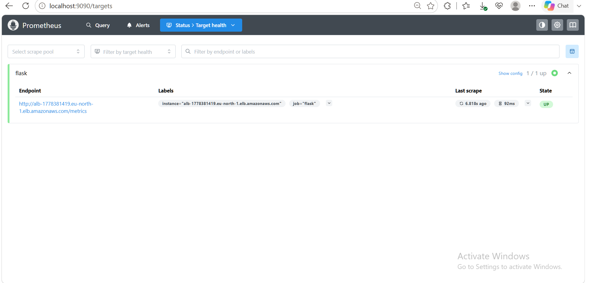
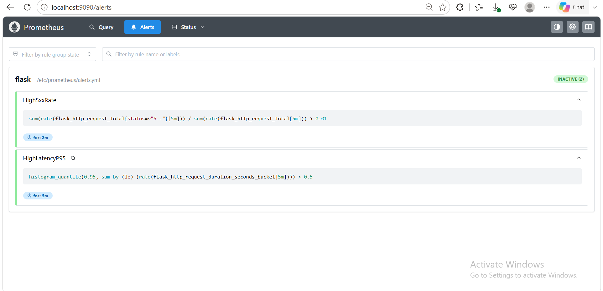
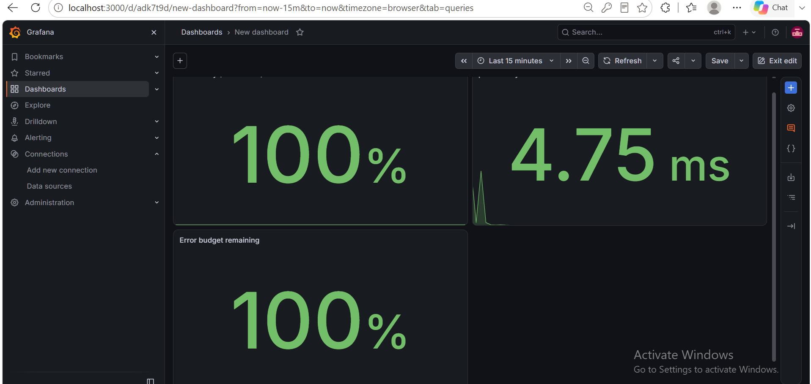

# AWS SAA + DevOps Comprehensive Project
> A comprehensive hands-on project that integrates AWS cloud services introduced in the SAA course with DevOps tools across multiple phases into one complete project.
 
## The purpose of building the project
This project is built as part of my AWS Solutions Architect Associate (SAA) certification journey combined with a DevOps learning path.
 
The goal is to integrate AWS cloud services (VPC, ALB, ASG, RDS, SSM, ECR, EKS, etc.) with modern DevOps tools (Terraform, Docker, GitHub Actions, Kubernetes) across multiple phases into a single, production-like project.
 
## By the end of this project, I will have:
 
- **A secure, scalable 3-tier architecture** on AWS (VPC, ALB, ECS, RDS) with strict network isolation and IAM least privilege.
- **Infrastructure as Code** using Terraform — VPC, subnets, ALB, ASG/ECS, RDS, SSM, VPC endpoints, SQS, SNS, Lambda, and CloudWatch.
- **Containerized applications** with Docker, ECR, and ECS on EC2 capacity, fronted by S3 + CloudFront.
- **CI/CD pipelines** with GitHub Actions, including SAST (CodeQL), dependency and image scanning (Trivy), automated ECR push, and ECS deployments with post-deploy health validation.
- **Event-driven architecture** using SQS, SNS, and Lambda for asynchronous background processing — Flask publishes events to SQS, Lambda processes them and fans out to SNS, delivering real email notifications.
- **Monitoring, logging, and secrets management** via CloudWatch, SSM Parameter Store, and KMS.
- **Kubernetes orchestration** on AWS (EKS) with Helm for container deployment and scaling.
- **Advanced observability** with Prometheus and Grafana for metrics, SLO dashboards, and alerting.
- **Remote Terraform state** managed via S3 backend with DynamoDB locking.
- **Production-grade documentation** with architecture diagrams and a detailed README.
## Phases
 
- **Phase 1:** Manual 3-Tier Architecture (VPC, ALB, EC2 ASG, RDS, IAM) — ✅ Complete
- **Phase 2:** Infrastructure as Code (Terraform: VPC, subnets, ALB, ASG, RDS, SSM, VPC endpoints) — ✅ Complete
- **Phase 3:** Containerization & CDN (Docker, ECR, ECS on EC2, S3 + CloudFront, ALB origin) — ✅ Complete
- **Phase 4:** CI/CD & Event-Driven Architecture (GitHub Actions, CodeQL, Trivy, SQS, SNS, Lambda, CloudWatch)
- **Phase 5:** Monitoring, Security & Secrets (CloudWatch, KMS, IAM hardening) — ⏳ Planned
- **Phase 6:** Terraform State Management (Remote Backend: S3 + DynamoDB lock) — ⏳ Planned
- **Phase 7:** Documentation & Exam Prep (README, architecture diagrams) — ⏳ Planned
- **Phase 8:** Kubernetes (EKS, kubectl, Helm) — ⏳ Planned
- **Phase 9:** Advanced Observability (Prometheus, Grafana) — ✅ Lab-level core complete (metrics, alerts, SLO dashboard); ECS service discovery and CloudWatch exporter still to add
## Architecture Overview
 
This project provisions a secure, scalable, decoupled 3-tier architecture on AWS.
 
### Presentation Tier
- **CloudFront** (HTTPS) serves the static frontend from a private **S3 bucket** via Origin Access Identity (OAI).
- A second CloudFront origin routes `/messages` to the **Application Load Balancer**, unifying frontend and API under one domain and eliminating CORS and mixed-content issues.
- The **ALB** sits in public subnets and forwards traffic to the application tier.
### Application Tier
- A **Flask API** runs as a containerized workload on **ECS (EC2 capacity)** in private subnets.
- The ECS cluster is fronted by the ALB with dynamic port mapping and target group health checks.
- **Auto Scaling** is managed at the ECS service level.
- On every new entry, the Flask app publishes an event to **SQS**; a **Lambda** function consumes it and publishes to **SNS**, delivering real-time email notifications.
- The app exposes Prometheus metrics at `/metrics` (see [Observability](#observability-prometheus--grafana)).
### Data Tier
- **RDS (MySQL)** resides in private subnets with no public access, accessible only from the ECS tasks.
### Security
- **Network isolation:** strict Security Group chaining (CloudFront → ALB → ECS → RDS); compute and database have no direct internet exposure.
- **IAM least privilege:** ECS task roles scoped to the minimum required actions; no long-lived credentials on instances.
- **Secrets management:** RDS credentials stored in **SSM Parameter Store** and injected at runtime.
- **Private connectivity:** **VPC Endpoints** for SSM, ECR, S3, ECS, and CloudWatch Logs keep traffic off the public internet — no NAT Gateway required.
- **VPC endpoints** for SQS keep event traffic private (no NAT).
- **Delivery:** all infrastructure is defined as code using **Terraform**.
## Observability (Prometheus + Grafana)
 
Lab-level monitoring stack that measures the Flask API against a defined SLO.
 
### How it works
 
```
Flask app (/metrics) ──► ALB ◄── scrape every 15s ── Prometheus ──► Grafana (SLO dashboard)
                                                          │
                                                          └──► alert rules (5xx rate, p95 latency)
```
 
- **Instrumentation:** `prometheus-flask-exporter` exposes request counts and latency histograms at `/metrics`.
- **Pull model:** the app sends nothing. Prometheus scrapes `/metrics` and stores the values as time series.
- **Scrape target:** the ALB directly. The CloudFront distribution only routes `/messages` to the ALB, so `/metrics` through CloudFront hits S3 and returns 403.
- **Stack:** Prometheus and Grafana run with Docker Compose on a separate VM, not inside the AWS account.
### Files (`monitoring/`)
 
| File | Purpose |
|---|---|
| `docker-compose.yml` | Runs Prometheus (`:9090`) and Grafana (`:3000`) |
| `prometheus.yml` | Scrape config, targets the ALB, loads alert rules |
| `alerts.yml` | Alert rules |
| `flask-slo-dashboard.json` | Exported Grafana dashboard |
 
> **Before running:** replace the ALB DNS in `prometheus.yml` with your own (no `http://`). It changes after every rebuild. Get it with:
> `aws elbv2 describe-load-balancers --query "LoadBalancers[].DNSName" --output text`
 
### SLI / SLO definitions
 
| | Definition |
|---|---|
| **SLI: availability** | Non-5xx requests ÷ total requests |
| **SLI: latency** | p95 request duration |
| **SLO** | 99.5% availability; p95 latency under 500 ms |
| **Error budget** | 0.5% of requests may fail |
 
### Alert rules
 
| Alert | Condition | For |
|---|---|---|
| `High5xxRate` | 5xx share of requests above 1% (5m rate) | 2m |
| `HighLatencyP95` | p95 latency above 0.5 s (5m rate) | 5m |
 
### Dashboard panels
 
| Panel | Query idea | Notes |
|---|---|---|
| Availability (SLO 99.5%) | non-5xx rate ÷ total rate (5m) | Unit: percent (0.0-1.0). Red below 0.995, green at or above |
| p95 latency | `histogram_quantile(0.95, ...)` over duration buckets | Unit: seconds |
| Error budget remaining | `1 - (5xx ratio over 1h ÷ 0.005)` | Unit: percent (0.0-1.0) |
 
### Run it
 
```bash
cd monitoring
docker compose up -d
```
 
Open Prometheus at `localhost:9090` (check `/targets` shows **UP** and `/alerts` lists both rules) and Grafana at `localhost:3000`. On a remote VM, use an SSH tunnel:
 
```bash
ssh -L 9090:localhost:9090 -L 3000:localhost:3000 <user>@<vm-ip>
```
 
In Grafana: add a Prometheus data source with URL `http://prometheus:9090`, then import `flask-slo-dashboard.json` and select that data source for the panels.
 
Generate traffic so the panels show data:
 
```bash
for i in $(seq 200); do curl -s -o /dev/null http://<alb-dns>/health; sleep 0.5; done
```
 
Tear down when finished:
 
```bash
docker compose down -v
```
 
### Screenshots
 



 
### Known limitations
 
- The ALB spreads requests across tasks, so each scrape hits one random task and counters can jump between scrapes. Production would use ECS service discovery to scrape every task.
- The error budget panel uses a 1-hour window as a lab approximation. A real 30-day budget needs longer retention or recording rules.
- Alerts are evaluated by Prometheus but not routed anywhere (no Alertmanager yet).
## Prerequisites
 
### Core (required from Phase 1)
- **Terraform** (≥ v1.0) — infrastructure provisioning.
- **AWS CLI** installed and configured with an IAM user that has sufficient permissions.
- **AWS region** set (e.g., `eu-north-1`).
### Phase 3 (Containers & CDN)
- **Docker** — building the Flask application image locally.
- **Amazon ECR** — container registry (created via Terraform).
- **AWS account access** to S3, CloudFront, and ECS.
### Phase 4 (CI/CD & Event-Driven)
- **GitHub repository** with Actions enabled.
- **GitHub Secrets** configured:
  - `AWS_ACCESS_KEY_ID`, `AWS_SECRET_ACCESS_KEY`, `AWS_REGION`
  - `ECR_REPOSITORY`, `ECS_CLUSTER`, `ECS_SERVICE`, `ECS_TASK_DEFINITION`, `CONTAINER_NAME`
  - `S3_BUCKET`, `CLOUDFRONT_DISTRIBUTION_ID`
  - `APP_URL` (full CloudFront URL including `https://`)
- **IAM user** `github-actions-deploy` with scoped permissions: ECR push, ECS register/update, `iam:PassRole`, S3 sync, CloudFront invalidation.
- **SNS email subscription** — confirm the AWS-sent verification link once.
- **Trivy** and **CodeQL** run inside the pipeline — no local install required.
### Phase 5+ (Planned)
- **Kubernetes tooling:** `kubectl`, `helm` (Phase 8).
### Phase 9 (Observability)
- **Docker** with the Compose plugin on the machine that runs the monitoring stack.
- Network access from that machine to the ALB DNS.
## Troubleshooting & Lessons Learned
 
Real issues hit and resolved during the build — recorded because the failures taught more than the successes.
 
### CI/CD Pipeline
 
**1. Trivy image scan grew from 54 → 62 CVEs after switching base images.**
- Cause: `python:3.11-slim` and `python:3.11-slim-bookworm` ship a different Debian userland than Trixie. CVE count alone is not a signal of risk.
- Resolution: Stay on stable Bookworm; gate on `ignore-unfixed: true` to suppress unfixable CVEs. Fix the fixable ones.
**2. Multi-stage build didn't remove `setuptools` / `wheel` / `jaraco.context`.**
- Cause: `pip install --prefix=/install` + `COPY --from=builder /install /usr/local` merges directories. Docker overwrites the package code, but the old `.dist-info/` metadata folder (different name) survives.
- Result: Two versions of metadata for one package. pip cannot uninstall the ghost.
- Resolution: Switched to an isolated **venv** (`python -m venv /venv`), copied the whole venv, and deleted the base image's `/usr/local/lib/python3.11/site-packages`.
**3. Nested vendored packages inside `setuptools/_vendor/`.**
- Cause: `setuptools` ships private copies of `jaraco.context`, `wheel`, etc. A glob (`*.dist-info`) only matches top-level entries — it doesn't recurse.
- Resolution: Same as above — the venv sidesteps this class of problem entirely.
**4. Health check returned `Invalid URL '***/health': No scheme supplied`.**
- Cause: `APP_URL` secret was missing the `https://` prefix. GitHub masked the value, making the error look mysterious.
- Resolution: Fix the secret; optionally harden the script to prepend `https://` if missing.
**5. Health check then returned `expected 200, got 403`.**
- Cause: `APP_URL` pointed at CloudFront, and `/health` is not routed to the ALB there, so the request reached the S3 origin, which returns 403 for missing files.
- Resolution: Point the health check at the ALB, or add a `/health*` behavior to CloudFront.
### Event-Driven Architecture
 
**6. Flask successfully saved to RDS, but SQS queue stayed empty.**
- Cause: ECS tasks run in private subnets with no NAT. Every AWS service they need requires a **VPC endpoint**. The SQS endpoint was missing (it wasn't part of Phase 3).
- Symptom: `except` block logged a timeout — but log group was misidentified, so the error looked silent.
- Resolution: Added `aws_vpc_endpoint` for SQS.
**7. `SQS_QUEUE_URL` was never injected into the ECS task.**
- Cause: Terraform defined the env var, but was never `apply`-ed. The CI pipeline's `describe → render → deploy` flow kept extending an old task definition without the variable.
- Resolution: `terraform apply` first (Terraform owns the task def structure); CI owns only the image.
**8. Lambda ran but no email arrived.**
- Cause: SNS email subscription was in `PendingConfirmation` state.
- Resolution: Click the confirmation link AWS sends after subscription creation.
### Rebuild After `terraform destroy`
 
**9. `terraform apply` failed with `RepositoryAlreadyExistsException` for ECR.**
- Cause: the ECR repository survived the destroy, so Terraform tried to create it again.
- Resolution: `terraform import aws_ecr_repository.repository <repo-name>`, then apply again.
**10. ALB returned 503 and the ECS task stopped with `CannotPullImageManifestError`.**
- Cause: after the rebuild the ECR repository had no image, because the pipeline had not pushed one yet.
- Diagnosis: `aws ecs describe-services` (running 0 / desired 1), then `aws ecs describe-tasks ... --query "tasks[].containers[].reason"`.
- Resolution: re-run the GitHub Actions pipeline (or push an empty commit). ECS retries and the task becomes healthy.
**11. The ALB DNS changes on every rebuild.**
- Anything that references it (`prometheus.yml`, the `APP_URL` secret) must be updated after each `terraform apply`.
### Observability
 
**12. `/metrics` returned 403 through CloudFront.**
- Cause: CloudFront routes only `/messages` to the ALB; everything else goes to S3.
- Resolution: scrape the ALB DNS directly, never the public CloudFront URL.
**13. Prometheus target showed `down` with HTTP 503.**
- Cause: the ALB had no healthy targets (see #10), so every scrape failed.
- Resolution: fix the ECS service first; the target turns UP on the next scrape.
**14. Grafana panel showed "No data".**
- Cause: Prometheus itself had no data because the target was down, and the default 6-hour range was wider than the stack's uptime.
- Resolution: test the query in Prometheus first, then set Grafana to "Last 15 minutes" and keep a traffic loop running.
**15. The AWS CLI installer folder was staged for commit.**
- Cause: `awscliv2.zip` was unzipped inside the repo and `git add .` picked up thousands of files.
- Resolution: `git restore --staged aws/`, delete the folder, add `venv/`, `aws/`, and `awscliv2.zip` to `.gitignore`, and stage only the intended files.
### General Patterns
 
**16. Terraform-managed vs CI-managed resources.**
- Terraform owns infrastructure structure (task definition, roles, env vars).
- CI owns deployments (image tag, service update).
- Reconciling both requires Terraform to run first when structure changes; CI then deploys on top.
**17. `pip uninstall` cannot remove ghosts.**
- It reads `.dist-info/RECORD` to know which files to delete.
- If Docker's COPY orphans a `.dist-info/` folder, pip loses the map and never removes the files.
- Isolation (venv) > cleanup (rm, uninstall) for this class of problem.
**18. Log group name mismatch wastes time.**
- Always verify with `aws ecs describe-tasks ... --query 'containers[0].logConfiguration'` instead of assuming.
## Sections to be added
 
This README is a living document and will continue to be expanded as the project progresses.
 
### Already added
- ✅ Project overview and phased roadmap.
- ✅ Architecture overview (3-tier with CloudFront, ECS, RDS, SQS, Lambda, SNS).
- ✅ Security posture (implemented vs. planned).
- ✅ Observability section (Prometheus, Grafana, SLI/SLO, alerts, dashboard).
- ✅ Prerequisites grouped by phase.
- ✅ Phases with concrete AWS services and tools.
- ✅ Troubleshooting & Lessons Learned — real failures and resolutions from Phases 2–4 and 9.
### In Progress
- **Architecture diagram** (draw.io).
- **Phase-specific screenshots** (pipeline runs, CloudWatch logs, email notifications, Prometheus and Grafana).
### Planned
- **ECS service discovery** for Prometheus and a **CloudWatch exporter** for ALB and RDS metrics.
- **Alertmanager** to route alerts.
- **Detailed per-phase runbooks** for full reproducibility.
- **Disaster Recovery strategy** — RDS snapshots, Terraform state recovery, multi-AZ.
 
